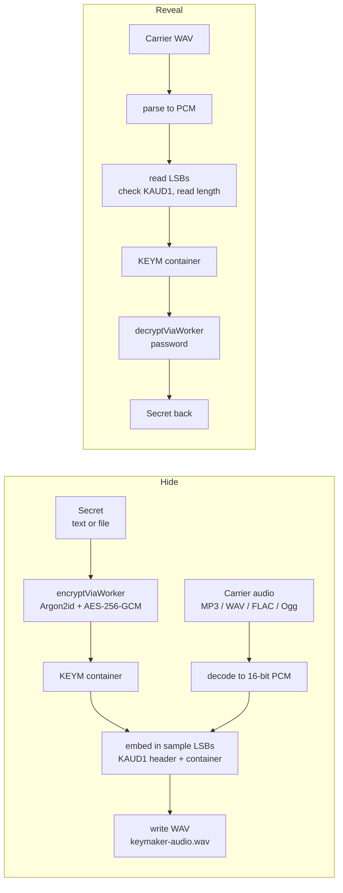

# KAUD1: the encrypted audio carrier layout

This note defines how Keymaker packs a KEYM container into an audio file. It is
the audio analogue of a paper vault (§7.1): a **carrier**, not a cipher. The
bytes packed into the audio are an ordinary KEYM v2/v3 container, so every
protection the container already has (Argon2id, AES-256-GCM, Shamir, the
independent Python decryptor) applies unchanged. Nothing here parses or weakens
that container.

**This is a carrier, not steganography.** It does not meaningfully hide *that* a
secret is present: the `KAUD1` magic sits in the first sample LSBs and the
container follows it sequentially, so a fixed-offset check or any LSB-histogram
steganalysis flags it immediately. All confidentiality is the container's; the
carrier's only job is to move an encrypted payload as an ordinary-looking audio
file. Genuine deniable steganography would need keyed placement, cover-aware
encoding and measured resistance to steganalysis, which is a separate project
and explicitly out of scope here.

## The two flows



The crypto is entirely inside `encryptViaWorker` / `decryptViaWorker`; the boxes
either side of them are this carrier. A carrier with no `KAUD1` header never
reaches `decryptViaWorker`: it is reported as "nothing hidden" at the read step.

## Why the output is always lossless

The payload lives in the least-significant bit of each PCM sample. Lossy codecs
(MP3, AAC, Ogg Vorbis) discard exactly that bit under psychoacoustic
quantisation, so a container embedded and then MP3-encoded is destroyed (measured
bit-error near 0.5, i.e. total loss). Therefore:

- **Input** may be MP3, FLAC, Ogg or anything else the browser can decode, or a
  WAV. A lossy input is decoded to PCM first; its compression artefacts are
  already baked into those samples, which is fine because they become the new
  lossless master.
- **A WAV is read directly, not by the browser's decoder**, because the browser
  resamples to the device's rate and that destroys the low bit. Integer PCM at
  8, 16, 24 or 32 bits and float at 32 or 64 bits are accepted, plain or
  `WAVE_FORMAT_EXTENSIBLE`, at their own sample rate. Anything other than 16-bit
  is scaled to 16 bits by a power of two, so a 16-bit carrier re-saved
  losslessly at a greater depth still gives back its payload. Other WAV
  encodings (ADPCM, A-law, µ-law) are refused with a message.
- **Output** is always lossless. Phase 1 writes **16-bit PCM WAV**. FLAC output
  is a later addition and uses the same stream defined here.

There is deliberately no MP3 output. It cannot carry the payload.

## The sample stream

A carrier is 16-bit signed PCM, one or more channels, samples stored
interleaved exactly as a WAV `data` chunk stores them. The payload is written
into the LSB of consecutive samples in that stored order, starting at the first
sample. Phase 1 uses **one bit per sample** (`lsbDepth = 1`); the depth is
recorded in the header so a future higher-capacity mode stays readable by the
same extractor.

## Header

The embedded bit-stream is a fixed 10-byte header followed by the container
bytes. All multi-byte integers are big-endian.

| offset | size | field        | value                                            |
|-------:|-----:|--------------|--------------------------------------------------|
| 0      | 4    | magic        | `4B 41 55 44` (ASCII `KAUD`)                     |
| 4      | 1    | version      | `01`                                             |
| 5      | 1    | lsbDepth     | `01` in Phase 1                                  |
| 6      | 4    | payloadLen   | container length in bytes, `uint32` big-endian   |
| 10     | N    | payload      | the KEYM container, `payloadLen` bytes           |

Bits are written most-significant-first within each byte. The extractor reads
the 80 header bits, checks the magic and version, then reads `payloadLen` bytes.
A carrier whose first 80 LSBs are not the magic is reported as "no hidden data
found", never routed to the AEAD.

## Capacity

Usable bytes at depth 1 = `floor(numSamples / 8) - 10` (the header). Embedding
refuses when `container.length + 10` exceeds that. A 3-minute 44.1 kHz stereo
track holds roughly 2 MB, which is far more than a text secret or a small file
needs.

## Reading a carrier without the app

A carrier is a backup, so it has to open without this app, the same promise
the paper vault (§7.1) and the self-extracting page (§7.2) keep. This section
is the procedure, written so that someone holding only a carrier file and this
document can recover the container. `reference/keym2.py` implements it, and
`src/lib/audio-stego.ts` reads carriers the same way. Where the two could
legally disagree, this section decides.

### 1. Recognise the file

A carrier is a RIFF/WAVE file. Bytes 0 to 3 are ASCII `RIFF` and bytes 8 to 11
are ASCII `WAVE`. The test is on the bytes, never on a file name or a media
type, because a carrier sent through a messenger or saved under another name
loses both.

`RI` begins none of the prefixed encodings §7 of FORMAT-V2-DESIGN.md defines
(`ke`, `KE`, `KM`, `IB`), so among those the order of a reader's checks does not
matter. The §7.2 page is the exception, because it is found by a substring
search rather than by a prefix, and a WAV can hold those bytes anywhere, in a
metadata chunk or by chance in its samples. So a reader that also looks for
pages **recognises a WAV before it searches for the page sentinel**. Nothing is
lost by that order, since a page is an HTML document and cannot begin `RIFF`.

**Audio that is not a WAV.** The most likely damaged copy of a carrier is one
that was converted, by saving it as MP3, sending it through a messenger that
re-encodes to Opus or AAC, or archiving it as FLAC. Such a file is not a container and not a
carrier, and a reader that treats it as a container asks for a password it can
never accept. A reader recognises these by their leading bytes, before any
password is asked for, and says what the file is.

| Leading bytes | What it is |
|---|---|
| `ID3`, or `FF` then any of `E2 E3 F2 F3 FA FB` | MP3 |
| `FF F1` or `FF F9` | AAC (ADTS) |
| `OggS` | Ogg (Vorbis or Opus) |
| `fLaC` | FLAC |
| `ftyp` at bytes 4 to 7 | MP4 or M4A (AAC or Apple Lossless) |
| `FORM` with `AIFF` or `AIFC` at bytes 8 to 11 | AIFF |
| `RF64` or `RIFX` with `WAVE` at bytes 8 to 11 | a WAV variant this reader does not take |
| `1A 45 DF A3` | WebM or Matroska |
| `#!AMR` | AMR |

None of these shares its first two bytes with a KEYM encoding (`ID3` and
`IBTZ` part at the second). The `ftyp` test is at byte 4, where a binary
container holds its version byte, which is never `f`. A lossy copy (MP3, AAC, Ogg, Opus, WebM, AMR) has lost the hidden data for
good. A lossless one (FLAC, AIFF, Apple Lossless) still has it, but only after it
is converted back to 16-bit WAV at its own sample rate, without resampling. The
message says both.

### 2. Read the samples

A file shorter than 44 bytes is refused. Otherwise walk the chunks from byte
12. Each chunk is a four-byte ASCII id, a `uint32` little-endian size, and that
many bytes of body, followed by one pad byte when the size is odd. The walk
stops when fewer than 8 bytes remain. When two chunks share an id, the later
one is used.

- **`fmt `.** A declared size under 16, or a file that does not hold the first
  16 bytes of the body, is refused as malformed. Body bytes the declared size
  covers beyond those 16 are not needed, and may run past the end of the file.
  The refusal happens where the walk meets the chunk, even when a later `fmt `
  chunk would have been valid. Read the format code (`uint16` at body offset
  0), the channel count (offset 2), the sample rate (`uint32` at offset 4) and
  the bits per sample (offset 14), all little-endian. When the format code is
  `0xFFFE` (`WAVE_FORMAT_EXTENSIBLE`), a declared size under 40, or a file that
  does not hold the first 40 bytes of the body, is refused as malformed in the
  same way. The real format code is then
  the `uint16` at body offset 24, and it counts only when the 14 bytes at body
  offset 26 are `00 00 00 00 10 00 80 00 00 AA 00 38 9B 71`. Any other
  sub-format GUID makes the encoding unknown.
- **`data`.** The samples. A declared size that runs past the end of the file
  is cut to the bytes the file holds.

A file with no `data` chunk is refused, and so is one declaring zero channels.
The encoding must be one of the five below, and anything else (ADPCM, A-law,
µ-law, other depths, an unknown sub-format) is refused with a message saying
so. The number of samples is the data length divided by the sample width,
rounded down. Each sample becomes a signed 16-bit value `s`.

| Encoding | Format code | Bits | `s` |
|---|---|---|---|
| Integer PCM | 1 | 16 | the little-endian `int16` itself |
| Integer PCM | 1 | 8 | `(u − 128) × 256`, where `u` is the unsigned byte |
| Integer PCM | 1 | 24 | `R(v / 256)`, where `v` is the little-endian signed 24-bit value |
| Integer PCM | 1 | 32 | `R(v / 65536)`, where `v` is the little-endian `int32` |
| IEEE float | 3 | 32 or 64 | `R(f × 32768)`, where a non-finite `f` counts as 0 |

`R(x)` is the integer nearest to `x`, and a value exactly halfway between two
integers goes to the larger one. That is JavaScript's `Math.round`, which the
app uses, and the rule exists so that every reader turns a tie into the same
sample. It is not the round-half-to-even many languages use by default. On a
sample exactly half a 16-bit step below a value, half-to-even keeps the low bit
only half the time and this rule always does. On a sample half a step *above*,
this rule moves every value up by one and loses the low bit, and so does any
other reader that follows it. That is the point. The two readers agree, and
neither recovers a payload the other would not. Computing `R` as
`floor(x + 0.5)` is wrong too, in a rarer way. For the largest double below one
half the addition itself rounds up to 1, and a 64-bit float sample can be
chosen to hit it. Take the floor, then add one only when what remains is at
least one half.
An `x` beyond the `int16` range, infinite ones included, is first brought to
the nearer end of that range. Every `s` is clamped to −32768 to 32767.

Each scaling divides by a power of two, so a 16-bit carrier re-saved at a
greater depth without loss gives back its exact samples, low bit included.

### 3. Read the header and the payload

The payload bit of a sample is its least-significant bit, `s & 1`, on the
two's-complement value. Bits are read in stored sample order, most-significant
first within each byte, exactly as Header above describes.

1. Read the first 80 samples as 10 bytes. Fewer than 80 samples is a
   truncated carrier.
2. Refuse unless bytes 0 to 3 are `KAUD`. This is the case of an ordinary
   music file, and it is reported as "no hidden Keymaker data", never as a
   wrong password.
3. Refuse a version other than `01`, and an `lsbDepth` other than `01`, each
   by name.
4. Read `payloadLen`. Refuse 0. Refuse a length whose bits would run past the
   last sample, and do it **before** allocating anything for the payload,
   because `payloadLen` is a `uint32` an attacker chooses and the check costs
   one multiplication.
5. Read `payloadLen` bytes from the samples that follow.

### 4. Hand over the container

The payload is a KEYM container in its binary form, and a reader treats it
exactly as it would a `.keym` file. Inspecting it, decrypting it and adding
shares to it all work unchanged. A file that fails any step above is reported
as a carrier problem, by name, before any password is asked for. A payload
damaged after an intact header is a damaged container, and the container's own
checks refuse it exactly as they refuse a damaged `.keym` file.

With `keym2.py` that is one command, because it reads a carrier wherever it
reads a container:

```
python3 keym2.py decrypt --in keymaker-audio.wav --out secret.txt
python3 keym2.py unpack-audio --in keymaker-audio.wav --out backup.keym
```

The second writes the container out on its own, for keeping beside the carrier
or for another tool.
